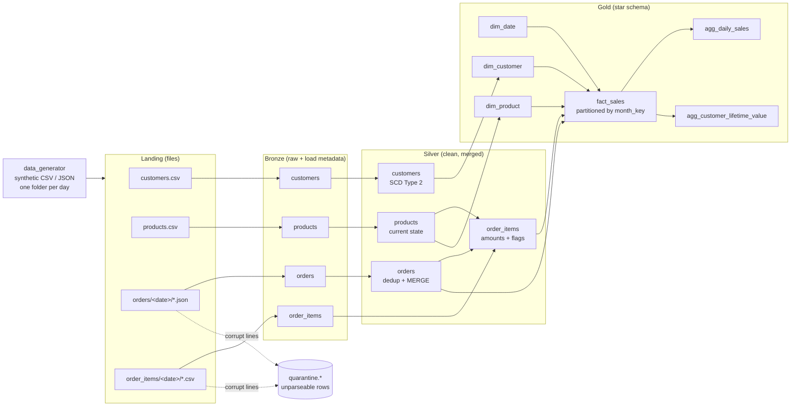
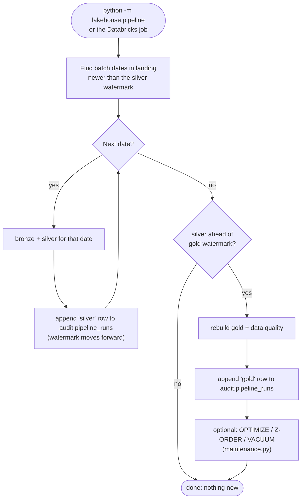
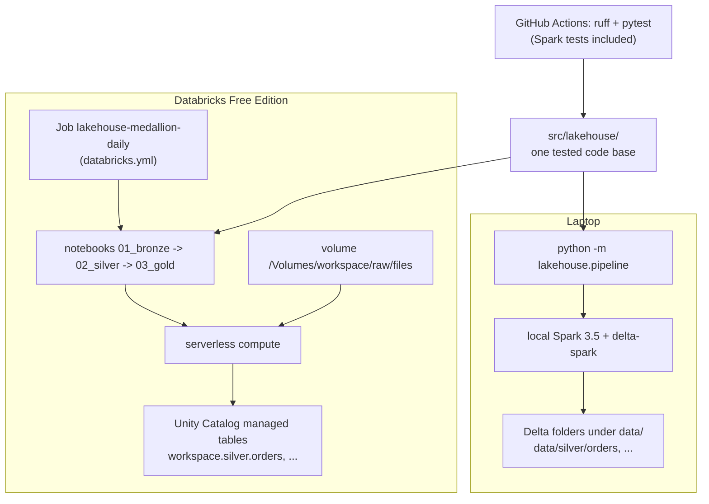

# Architecture

This page shows how data moves through the pipeline, where every table
lives, and how the same code runs on a laptop and on Databricks. The
diagrams are written in [Mermaid](https://mermaid.js.org/), which GitHub
renders directly on this page.

## Data flow

Read it left to right. Each arrow is one transform in `src/lakehouse/`:

| Step | Code | What happens |
|------|------|--------------|
| landing -> bronze | `bronze/ingest.py` | Read with an explicit schema, add `_source_file`, `_ingested_at`, `_batch_date`, `_run_id`; replace that day's partition. Corrupt lines go to quarantine. |
| bronze -> silver | `silver/*.py` | Clean and standardise (pure functions in `transforms.py`), deduplicate, Delta `MERGE` for orders, SCD Type 2 for customers. |
| silver -> gold | `gold/*.py` | Rebuild dimensions with surrogate keys (and an "unknown" row `-1`), the fact table at order-line grain, and the aggregates. |
| every layer | `quality/suites.py` | Rules such as unique keys, no orphan foreign keys, valid amounts. `error` checks stop the run. |

## Control flow and bookkeeping

Three audit tables make every run explainable afterwards:

| Table | Written by | Answers |
|-------|-----------|---------|
| `audit.ingestion_log` | bronze ingestion | How many rows did each file load, and how many were quarantined? |
| `audit.pipeline_runs` | the runner / notebooks | What has been processed (the watermarks), and which stage failed? |
| `audit.dq_results` | data quality suites | Which rule failed, on which table, and how many rows broke it? |

## Two ways to run the same code

The only switch between the two is `PipelineConfig.catalog`:

| | Local | Databricks |
|---|---|---|
| Config | `load_config()` | `unity_catalog_config("workspace")` |
| Landing files | `data/landing/` | `/Volumes/<catalog>/raw/files/landing/` |
| Table address | folder path, `data/silver/orders` | name, `<catalog>.silver.orders` |
| Spark | local session from `utils/spark.py` | the notebook's `spark` (serverless) |
| Orchestration | `lakehouse.pipeline` CLI | Databricks job, one task per layer |

Code never reads or writes a table by hand-built path; it calls
`config.table_path(layer, table)` and the helpers in `utils/tables.py`,
which decide between a Delta folder and a catalog table.

## Table reference

| Layer | Table | Grain | Load pattern |
|-------|-------|-------|--------------|
| bronze | `customers`, `products` | one row per row of the daily snapshot | replace the batch-date partition |
| bronze | `orders`, `order_items` | one row per source record, duplicates kept | replace the batch-date partition |
| quarantine | one table per source | one unparseable line | append |
| silver | `customers` | one row per customer version (SCD2) | close changed rows, insert new versions |
| silver | `products` | one row per product | MERGE, Type 1 (current state) |
| silver | `orders` | one row per order | dedupe, then MERGE (newest wins) |
| silver | `order_items` | one row per order line | dedupe, then MERGE on the line key |
| gold | `dim_date` | one row per calendar day | full rebuild |
| gold | `dim_customer` | one row per customer version, plus `-1` | full rebuild |
| gold | `dim_product` | one row per product, plus `-1` | full rebuild |
| gold | `fact_sales` | one row per order line | full rebuild, partitioned by `month_key` |
| gold | `agg_daily_sales` | one row per day | full rebuild |
| gold | `agg_customer_lifetime_value` | one row per customer | full rebuild |
| audit | `ingestion_log`, `pipeline_runs`, `dq_results` | one row per load / stage / check | append |

The [build log](build-log.md) explains the reasoning behind each of these
choices, step by step.
